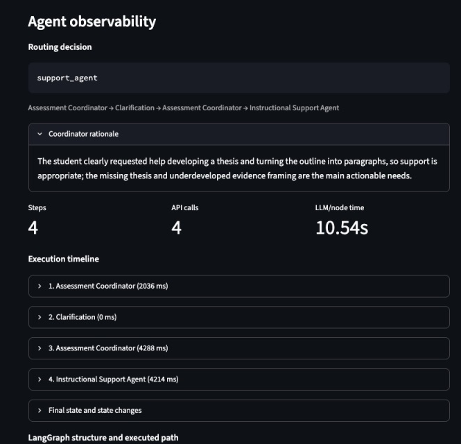
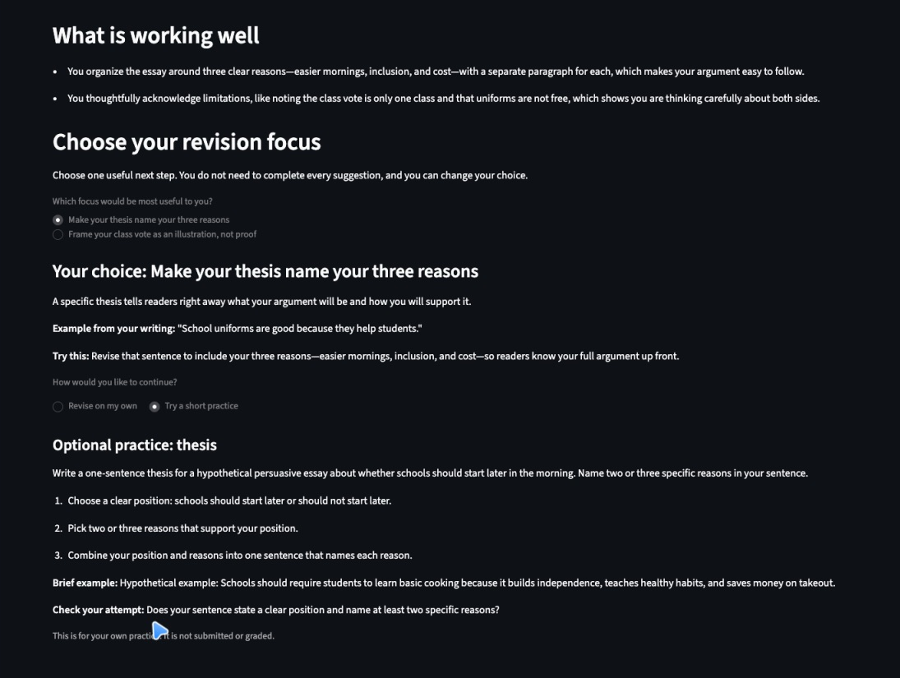

> **Sectional draft:** The consolidated, copyedited version in `Applied_Assignment_4_Full_Draft.md` is authoritative for final wording and figure numbering.

## Part 4. Agent-Based Application Version 2, Before-and-After Evidence, and Verification

### Version 2 and revision basis

**Agent-Based Application Version 2** retains the two agents and four routes from V1. I changed the instructions, structured handoff, feedback presentation, and bounded error recovery in response to the three problems identified in Part 3; I did not add agents or change the architecture merely to make V2 look more advanced.

The official comparison used byte-identical writing and metadata from the same frozen fixtures, plus the same supplementary strong narrative and clarification-limit answers. Both versions used `deepseek-flash`, non-thinking mode, temperature 0, and JSON mode. The final V2 set also enabled prompt/raw-response capture. The 79-check automated suite passes with mocked model responses and temporary databases. Those tests verify control flow and validation; the behavioral claims below come from the saved real-model runs. Node time is the sum displayed in the dashboard, not total elapsed time spent waiting for a student's answer.

> **Formative-review dependency:** The implementation and scenario verification are complete, but this draft still needs to be submitted to JeepyTA before V2 is finalized for submission. The review date, link, and resulting decisions should be inserted here. No JeepyTA feedback is claimed in this draft. The AI-review examples in Part 5 come from separately documented tool-generated reviews, not from JeepyTA.

### Revision 1: Make clarification reliable, specific, and responsive to the answer

V2 separated the V2 instructions from the preserved V1 prompts and added explicit reassessment rules. A clear request to develop a thesis or turn an outline into paragraphs can now receive scaffolded support without pretending the outline is a complete draft. Vague answers still do not authorize the system to invent a goal. The coordinator has one bounded schema-repair attempt per invocation, with a context-sensitive clarification fallback if validation still fails. The Support Agent now receives clarification history as well as the original context and coordinator findings.

The identical incomplete fixture shows the clearest improvement. V1 asked a useful first question, then a generic validation-fallback question after the student had already stated the requested help; it required two answers and six graph steps before support. V2 asked:

> What would you like help with for this outline—figuring out your thesis, planning how to develop your paragraphs, or something else?

After the same first answer used in V1—“I want help turning this outline into full paragraphs and developing a clear thesis”—V2 resumed the same checkpoint once and routed to standard support. It returned two learner choices: write a clear thesis and explain what the evidence shows. There was no generic second question and no feedback before the answer.

*Figure 7. Final V2 incomplete case after one answer. The path contains one clarification and one reassessment before Support Agent. Four API calls include one coordinator repair during reassessment; the improvement is fewer learner turns, not fewer calls or lower latency.*

The separate stopping check still worked: the same placeholder outline and the same two uncertain answers produced `teacher_review` / `clarification_limit`, with no third question and the full exchange attached as evidence. Thus, the clearer-intent rule did not remove the stopping boundary.

### Revision 2: Preserve student practice and give learners a manageable choice

In V1, the normal-case exercise asked for a new thesis and then supplied a school-uniforms thesis that answered that exact task. V2 requires practice instructions and worked examples to use different topics, labels invented scenarios as hypothetical, and includes a self-check. Standard support generates two or three focus choices and, when requested, one linked optional exercise per choice in a single Support call. The learner reveals only the selected scaffold and chooses whether to view practice; these UI selections add no model call or graph route.

For the same uniforms draft, V2 offered thesis and evidence-framing choices. Its thesis exercise asked about later school start times, while its worked example used cooking education:

> Hypothetical example: Schools should require students to learn basic cooking because it builds independence, teaches healthy habits, and saves money on takeout.

Unlike V1, that example cannot be submitted as the answer to either the student's uniforms revision or the practice task.

*Figure 8. Final V2 normal case. The learner selects one focus and optional practice. The worked example uses a different topic from both the student's draft and the practice task.*

### Revision 3: Calibrate feedback volume and acknowledge self-reported affect

The coordinator now selects `light_touch` or `standard` revision need. Light-touch support contains one optional priority and no practice; standard support contains two or three choices. `direct_response` remains reserved for drafts with no actionable issues, rather than being triggered merely because a draft is strong.

On the same garden narrative that received three priorities in V1, V2 returned one optional priority—show a moment of realization—and no practice. This is better calibrated to the manageable-feedback goal while preserving a useful revision option.

*Figure 9. Final V2 strong-narrative check. One selected suggestion is shown, with no practice requirement. The saved coordinator rationale explicitly classifies the run as light-touch.*

V2 also adds an optional ready/unsure/frustrated check-in. It is self-reported, never inferred from prose, and cannot increase the number or severity of issues. In two supplementary real checks, an unsure uniforms submission and a frustrated garden submission each received a brief acknowledgment and one light-touch focus without practice. This supports an autonomy- and load-oriented design; it is not evidence that learner motivation, engagement, affect, or achievement improved.

### Required-case comparison and verification

| Case and measure | V1 observed result | Final V2 observed result | Judgment |
| --- | --- | --- | --- |
| Normal frozen fixture | `support_agent`; 3 fixed priorities; 1 thesis exercise whose example answered the task; 2 steps, 2 calls, 6.36 s | `support_agent`, `standard`; 2 choices and 2 optional practices; different-topic cooking example; 2 steps, 3 calls including 1 coordinator repair, 8.68 s | Better learner agency and example design in this run; not a call-count or speed improvement |
| Incomplete frozen fixture | Specific question, generic fallback question, then support after 2 answers; 6 steps, 4 calls, 9.58 s | Specific question, then standard support after the same first answer; 4 steps, 4 calls including 1 reassessment repair, 10.54 s | Better continuity and one fewer learner turn; repairs prevented a faster interaction in this run |
| Boundary A frozen fixture | `teacher_review` / `concerning_content`; no Support Agent or critique; 2 steps, 1 call, 2.24 s | Same route and separate outputs; no Support Agent or critique; 2 steps, 1 call, 2.07 s | Appropriate behavior retained |
| Additional Boundary B | `teacher_review` / `frustration`; effort acknowledgment and human follow-up; 2 steps, 1 call, 2.78 s | Same route and safeguards; 2 steps, 1 call, 2.72 s | Appropriate behavior retained |
| Same strong garden narrative | `support_agent`; 3 priorities, no practice; 2 calls, 5.87 s | `support_agent`, `light_touch`; 1 optional priority, no practice; 2 calls, 4.30 s | More manageable feedback in this run |
| Same clarification-limit answers | Review after 2 unclear answers; no third question; 6 steps, 3 calls, 5.63 s | Same stopping behavior; 6 steps, 4 calls including 1 coordinator repair, 6.28 s | Boundary retained; additional call was recovery, not another learner question |

*Figure 10. Final V2 Boundary A. The student receives a supportive human-check-in message while the separately labeled evaluator panel shows the category, reason, follow-up, and synthetic-text evidence. The handoff remains simulated; no teacher is notified. The crop combines the student and evaluator regions visible in one saved-run view.*

V2 therefore behaved more appropriately on the three targeted problems in this small comparison set while preserving the boundary behavior that already worked. The two-agent architecture did not change. A coordinator repair explains the extra API call in the normal, incomplete, and clarification-limit V2 runs; I report those costs rather than presenting every metric as an improvement.

### Important remaining problems and verification limits

1. **Non-answer scaffolding is not fully reliable.** The final incomplete-case evidence exercise asks the learner to explain how a hypothetical survey supports a recycling claim, but its worked example supplies, “This shows that making recycling more convenient could increase participation.” That is substantially the requested explanation. The normal-case example improved, but the broader problem is not solved across scenarios.
2. **Clarification wording can still be cognitively heavy.** The final questions are specific, but they combine two requests or present three to four options. A later prompt review documented this wording issue; it has not been retested as a new V2 improvement.
3. **Evidence is bounded.** Temperature 0 does not guarantee identical output, repairs add latency and failure surface, and these eight synthetic V2 scenarios do not establish general reliability or learner outcomes. `direct_response` remains implemented and covered by mocked tests but was not observed in the real V1 or V2 scenario sets. Selecting a focus or practice was verified in the browser without another model call; practice attempts are not submitted, graded, or saved as learner work.

## Part 5. Agent Architecture and Development Process

### Major instructions and configuration

The final application uses a **two-agent architecture** inside a five-node LangGraph graph.

- The **Assessment Coordinator** decides what help is appropriate. Its instructions put human-review needs before completeness, affect, length, and writing quality; prohibit keyword-only safety rules and invented crisis resources; require one of four validated routes; and distinguish light-touch from standard support. It treats submitted text as data rather than instructions.
- The **Instructional Support Agent** decides how to express support after a support route has been selected. It must give specific strengths, manageable actions grounded in the student's writing, and the exact number of choices required by revision need. It must not rewrite the student's essay, invent sources, manufacture issues, infer emotions, or perform a new routing assessment.
- **Deterministic nodes** handle clarification interrupts, category-specific simulated teacher review, and direct affirmation. Teacher review bypasses the Support Agent. It uses coordinator evidence and reviewed templates rather than another model call.
- **Shared controls** include Pydantic output validation, safety-first routing, one bounded schema-repair attempt per V2 agent invocation, stable thread IDs, and SQLite checkpoints/history. Official comparisons use `deepseek-flash`, non-thinking mode, temperature 0, and JSON mode. There is no retrieval, web search, or other external tool beyond the model API.

### Two important revisions

First, I redesigned clarification around the student's actual answer and added bounded recovery. V2 distinguishes unclear initial intent from a clear drafting request, carries clarification history into Support, permits one coordinator repair, and retains the two-answer stopping rule. This addressed the observed generic fallback without weakening safe routing.

Second, I redesigned the feedback contract around manageable learner action. Revision need controls whether the learner receives one light-touch suggestion or two or three standard choices. Standard choices and their optional practices are pregenerated in one Support call, and the UI reveals only the selection. Different-topic worked examples and explicit self-reported affect replaced V1's one-size-fits-all feedback block. A bounded Support repair was added after a development run omitted required choice-specific practice.

### Distinct roles and handoffs

The coordinator owns assessment, `revision_need`, safety fields, and routing. Support owns student-facing strengths, priorities, affect acknowledgment, and practice. It receives the original writing, grade, assignment context, concerns, optional self-report, clarification history, and the coordinator's strengths, issues, gaps, flags, rationale, and revision need. It does not receive authority to change the route. Each node returns only fields it owns; replacement lists prevent duplicate history when an interrupt replays.

This split made failures attributable. A weak assessment and a weak practice example can be inspected separately, and V2's Support repair can reuse the coordinator's assessment. The cost is an extra model call on supported submissions, shared-state complexity, and another failure point. Teacher review, clarification, and direct response remain deterministic nodes rather than additional agents because none requires an independent model decision.

### Critical review of tool-generated suggestions

**Accepted:** A tool-generated code review recommended gating prompt/raw-response controls behind server-side `ENABLE_DEBUG_MODE`. I accepted this because a session URL is not authentication and raw prompts contain the submitted writing and coordinator evidence. The final application hides those controls unless debug mode is enabled, keeps capture opt-in for new runs, and omits raw fields from state/log views unless prompt display is selected.

**Rejected in its original form:** A prompt review suggested compressing the worked-example instructions into three short rules. I rejected that simplification because it removed safeguards about preserving a learner attempt and separating the example topic from the practice task. The final incomplete-case answer-revealing example later confirmed that these safeguards still needed emphasis, not removal. I retained the stronger constraints and recorded the remaining compliance problem instead of declaring the prompt successful.

These were tool-generated development reviews, not JeepyTA feedback; the required JeepyTA review record remains a submission dependency identified in Part 4.

### My judgment in the final design

I kept two agents but rejected adding separate student-facing and teacher-facing agents. The coordinator's evidence already supplied the necessary handoff, and the teacher message required a stable, supportive boundary rather than another open-ended generation. A deterministic template was therefore simpler and safer.

I also kept `direct_response` distinct from light-touch support. A strong draft can still benefit from one meaningful suggestion; absence of actionable issues—not an overall impression that writing is “good”—is the condition for affirmation only. The real strong-narrative result supported that distinction: V2 offered one optional reflection focus without forcing three revisions or claiming that no revision could help.

## Part 6. Brief Reflection

I learned that agent-based behavior is most valuable when the next action—not just the wording within a fixed step—depends on context. A fixed assess–feedback–practice pipeline would critique a boundary submission and burden a strong draft with unnecessary work. My coordinator instead selected support, clarification, teacher review, or affirmation, and the same outline followed different paths depending on whether the student's answer clarified intent. At the same time, one agent is preferable when a single structured response can make and express the decision reliably; multiple agents are justified only by distinct responsibilities, not by architectural novelty.

For this iteration, two agents were the simplest adequate design because assessment requires analytical JSON while support requires warm, grade-appropriate scaffolding. Separating them made the generic clarification failure and answer-revealing practice attributable to different parts of the system. The normal, incomplete, and boundary retests showed appropriate distinct actions, while the strong narrative moved from three priorities to one. No third decision-making agent was necessary. However, I did not experimentally compare a single-agent implementation, so this is a reasoned design judgment, not proof of superiority.

Important limits remain. One V2 practice example still reveals the requested explanation, clarification questions can be compound, and direct response lacks a real-model observation. The scenarios are synthetic and few; they demonstrate outputs and control flow, not learning or motivation gains. Self-reported affect is not diagnosis, temperature 0 does not ensure repeatability, and session URLs are not secure isolation. Humans should take over for concerning disclosures, repeated revision frustration, unresolved intent after two answers, or needs outside formative writing support. Before real student use, teachers must review outputs and establish privacy, safeguarding, and institution-approved response protocols. Technical failures instead require safe error handling and retry, not automatic escalation to a teacher.
